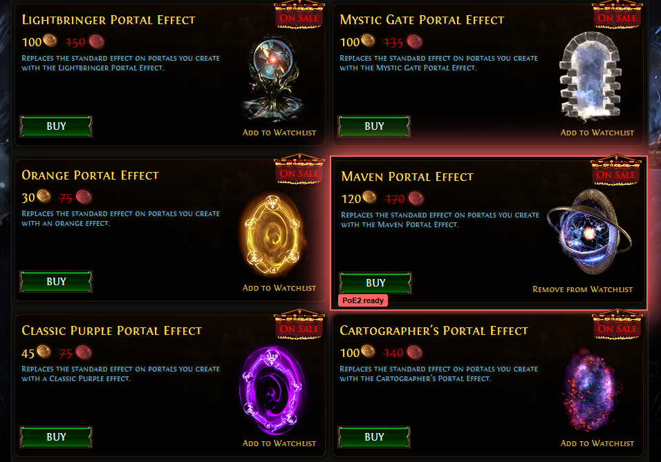
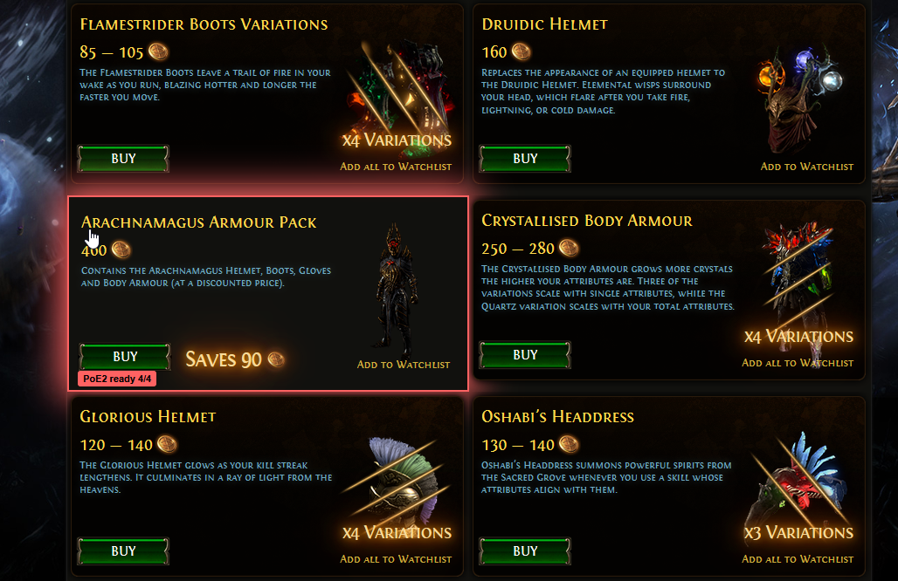

# PoE2 MTX Marker

A browser extension for the **Path of Exile shop** ([pathofexile.com/shop](https://www.pathofexile.com/shop)).
It highlights every item whose microtransaction is also available in **Path of Exile 2**, so you can see
at a glance what you can use in both games before you buy it.

The data comes from the PoE2 microtransaction list on [poe2db.tw](https://poe2db.tw/us/Microtransactions).
Marked items get a glowing frame and a **PoE2 ready** label. Bundles and variant groups show how many of
their items are in PoE2, e.g. **PoE2 ready 4/4**.

Works in **Firefox**, **Chrome**, **Edge** and other Chromium browsers (Brave, Opera, Vivaldi).

## Screenshots

## Download

**[Latest release](https://github.com/Aethermage-Arcanum/poe2-mtx-marker/releases/latest)**

| Browser | File |
| --- | --- |
| Firefox (109 or newer) | `poe2-mtx-shopmarker-<version>.xpi`, signed by Mozilla |
| Chrome, Edge, Brave, Opera, Vivaldi (Chromium 116 or newer) | `poe2-mtx-marker-chromium-<version>.zip` |

## Installation

### Firefox

1. Download the `.xpi` file from the latest release.
2. Open it in Firefox (or drag it into a Firefox window) and confirm with **Add**.
3. If the extension's popup says that access to the websites is missing, open `about:addons` >
   **PoE2 MTX Marker** > **Permissions** and allow access to pathofexile.com and poe2db.tw.

### Chrome, Edge and other Chromium browsers

The extension is not in the Chrome Web Store, so it is installed as an unpacked extension:

1. Download the `.zip` file from the latest release and extract it to a folder that stays where it is
   (the browser loads the extension from there).
2. Open `chrome://extensions` (Edge: `edge://extensions`).
3. Turn on **Developer mode**.
4. Click **Load unpacked** and select the extracted folder (the one that contains `manifest.json`).

To update: replace the folder's contents with the new release and click the reload button on the
extension's card. The browser may remind you now and then that a developer-mode extension is active.

## Usage

Open any shop category, e.g. [pets](https://www.pathofexile.com/shop/category/pets). All language
versions of the site work (www., de., fr. …). Items that load while you scroll are marked too.

- **Popup** (click the toolbar icon): number of marked items on the current page and the age of the data.
- **Options**: frame colour and glow intensity, with a live preview.

## How it works

- Each time you open a shop page, the extension loads the current PoE2 microtransaction list from
  poe2db.tw.
- An item counts as available in PoE2 if its shop ID belongs to an entry on that list or if it uses the
  same artwork as a listed entry. The mapping from poe2db entries to shop IDs comes with the extension.
  For new entries the extension looks up poe2db's detail pages itself, at most one request every 1.2 seconds.
- If poe2db cannot be reached, the extension uses the last list it loaded and shows a "Data as of …"
  notice on the page.
- The extension only reads what is on the shop page and adds the frame and label. It does not use the shop's
  API and does not change anything else on the page.

## Privacy

- **No account access.** The extension does not read your login, your points or your purchases, and it
  never clicks or buys anything.
- **No tracking.** There is no analytics, no telemetry and no server of its own.
- **Only one outside service:** public pages on poe2db.tw, requested without cookies.
- **Stored locally only:** your colour settings, the cached poe2db list and the ID mapping, in your
  browser's extension storage. Removing the extension removes them.
- **Permissions:** `storage` (settings and cache), access to `pathofexile.com` (to mark the shop page) and
  `poe2db.tw` (to load the list). The Chromium build also needs `offscreen`, which it uses to read
  poe2db's HTML pages.

## Limits

- The result is only as good as poe2db's list. If poe2db lists an item wrongly or late, the marking is
  wrong or late as well.
- If Grinding Gear Games changes the shop's page layout, marking can stop working until the extension is
  updated.
- This is an unofficial fan project, not affiliated with Grinding Gear Games or poe2db.tw.

## Development

No build step. Tests: `npm install`, then `npm test`. Build: `npm run build` (Firefox) and
`npm run build:chromium`. Architecture, matching rules, signing and acceptance tests are described in
[docs/DEVELOPMENT.md](docs/DEVELOPMENT.md) (German).
